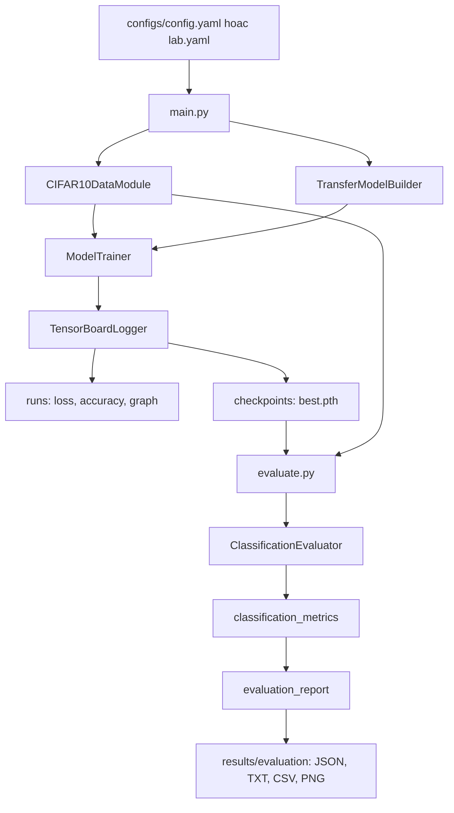

# README bài lab — giải thích toàn bộ dự án và từng bước chạy

Đây là hướng dẫn chính để làm bài thực hành **Hands-on Practice with Pre-trained Neural Network
Architectures**. Các lệnh dùng PowerShell trên Windows và được chạy từ thư mục gốc dự án.
Dùng trực tiếp `venv\Scripts\python.exe` để mỗi lệnh luôn chạy đúng môi trường, không cần activate.

## Mục lục

1. [Bài toán và kiến thức cần hiểu](#bai-toan)
2. [Cấu trúc và vai trò từng file](#cau-truc)
3. [Luồng kết nối toàn bộ chương trình](#luong-chay)
4. [Bước 1 — chuẩn bị môi trường](#buoc-1)
5. [Bước 2 — kiểm tra và tải dữ liệu](#buoc-2)
6. [Bước 3 — chạy kiểm thử](#buoc-3)
7. [Bước 4 — thử nghiệm nhanh và tinh chỉnh siêu tham số](#buoc-4)
8. [Bước 5 — huấn luyện và lưu checkpoint](#buoc-5)
9. [Bước 6 — xem TensorBoard](#buoc-6)
10. [Bước 7 — đánh giá mô hình phân loại](#buoc-7)
11. [Bước 8 — đọc kết quả và viết báo cáo lab](#buoc-8)
12. [Lộ trình nhanh khi đã có checkpoint](#chay-nhanh)
13. [Các lỗi thường gặp](#loi-thuong-gap)
14. [Notebook và Linux/macOS](#notebook)
15. [Các file đã được sắp xếp lại](#sap-xep)

<a id="bai-toan"></a>
## 1. Bài toán và kiến thức cần hiểu

Đầu vào là ảnh màu RGB; đầu ra là một trong 10 lớp CIFAR-10:
`airplane`, `automobile`, `bird`, `cat`, `deer`, `dog`, `frog`, `horse`, `ship`, `truck`.
CIFAR-10 có 50.000 ảnh train và 10.000 ảnh test; ảnh gốc có kích thước 32×32.
Dự án resize ảnh lên 224×224 và chuẩn hóa theo mean/std ImageNet để dùng với backbone huấn luyện sẵn.

| Khái niệm | Ý nghĩa trong dự án |
| --- | --- |
| Pretrained model | ResNet-18, VGG16 hoặc DenseNet121 đã học đặc trưng từ ImageNet |
| Backbone | Các lớp có sẵn dùng để trích xuất đặc trưng của ảnh |
| Classification head | Lớp Linear cuối được thay để trả ra 10 giá trị cho CIFAR-10 |
| Transfer learning | Tái sử dụng đặc trưng đã học và huấn luyện head trên bài toán mới |
| Freeze | Đặt `requires_grad=False` cho tham số cũ; chỉ head cuối nhận cập nhật gradient |
| Batch | Nhóm ảnh xử lý trong một bước tính toán |
| Epoch | Một lượt đi qua toàn bộ tập train đang dùng |
| Learning rate | Mức thay đổi tham số của optimizer ở mỗi bước |
| Weight decay | Tham số regularization của optimizer; dự án dùng để thử ảnh hưởng của L2 |
| Checkpoint | File `.pth` lưu trọng số, có thể kèm optimizer, epoch và chỉ số |

Code hiện tại huấn luyện lớp phân loại cuối với backbone được freeze tham số.
Nếu muốn fine-tuning thêm các lớp backbone, cần thay đổi cách đặt `requires_grad`;
chỉ đổi tên kiến trúc trong YAML không tự mở khóa backbone.

<a id="cau-truc"></a>
## 2. Cấu trúc và vai trò từng file

```text
Practice-2---Hands-on-practice-with-pre-trained-neural-network-architectures/
├── main.py
├── experiments.py
├── evaluate.py
├── README.MD
├── requirements.txt
├── requirements-dev.txt
├── configs/
│   ├── config.yaml
│   ├── lab.yaml
│   └── evaluation.yaml
├── src/
│   ├── __init__.py
│   ├── data_module.py
│   ├── model_builder.py
│   ├── trainer.py
│   ├── logger.py
│   ├── checkpoint_utils.py
│   ├── evaluator.py
│   ├── classification_metrics.py
│   └── evaluation_report.py
├── scripts/
│   ├── __init__.py
│   └── check_data.py
├── tests/
│   ├── test_model_builder.py
│   ├── test_trainer.py
│   ├── test_logger.py
│   └── test_evaluation.py
├── notebooks/
│   ├── experiment_demo.ipynb
│   └── src_output_demo.ipynb
├── docs/
│   ├── README_LAB.md
│   ├── EVALUATION.md
│   ├── PROJECT_REVIEW.md
│   └── references/
├── results/
│   ├── README.md
│   ├── experiments/
│   └── evaluation/
├── data/                    # Du lieu CIFAR-10 cuc bo
├── checkpoints/             # Trong so da huan luyen
├── runs/                    # Log TensorBoard
└── venv/                    # Moi truong Python cuc bo
```

| File | Trách nhiệm | Cần đọc/chỉnh khi nào? |
| --- | --- | --- |
| [main.py](../main.py) | Đọc cấu hình, tạo dữ liệu/model/trainer/logger, chạy epoch và lưu best checkpoint | Chạy huấn luyện đầy đủ hoặc nạp checkpoint để học tiếp |
| [experiments.py](../experiments.py) | Tách validation, thử các cấu hình, ghi CSV | Làm phần learning rate, batch size, weight decay |
| [evaluate.py](../evaluate.py) | Ghép các module đánh giá, nạp checkpoint, chạy test và xuất báo cáo | Tính chỉ số cuối cùng cho mô hình đã học |
| [configs/config.yaml](../configs/config.yaml) | Cấu hình huấn luyện mặc định | Thay số epoch, kiến trúc và siêu tham số |
| [configs/lab.yaml](../configs/lab.yaml) | Cấu hình ResNet18 1 epoch, batch 16 | Chạy bài lab đầu tiên trên toàn bộ train |
| [configs/evaluation.yaml](../configs/evaluation.yaml) | Cấu hình dữ liệu, checkpoint, thiết bị, số ảnh test | Thay thiết lập đánh giá mặc định |
| [src/data_module.py](../src/data_module.py) | `CIFAR10DataModule`: dataset, resize, augmentation, normalize, DataLoader | Tìm hiểu luồng dữ liệu và batch |
| [src/model_builder.py](../src/model_builder.py) | Các builder và factory `TransferModelBuilder` | Tìm hiểu thay head và đóng băng tham số |
| [src/trainer.py](../src/trainer.py) | `ModelTrainer`: train/evaluate/fit, cross-entropy, Adam hoặc SGD | Tìm hiểu vòng lặp học và backpropagation |
| [src/logger.py](../src/logger.py) | `TensorBoardLogger`: scalar, graph, ảnh, histogram, checkpoint | Theo dõi quá trình học và quản lý trọng số |
| [src/checkpoint_utils.py](../src/checkpoint_utils.py) | Tìm checkpoint, nhận diện kiến trúc, nạp state_dict | Tìm hiểu cách đánh giá checkpoint cũ |
| [src/evaluator.py](../src/evaluator.py) | `ClassificationEvaluator`: inference và thu thập xác suất/nhãn | Dùng bộ đánh giá từ mã Python |
| [src/classification_metrics.py](../src/classification_metrics.py) | Tính accuracy, P/R/F1, specificity, ROC AUC, AP | Tìm hiểu phép tính chỉ số phân loại |
| [src/evaluation_report.py](../src/evaluation_report.py) | Xuất JSON/TXT/CSV và biểu đồ PNG | Xem cấu trúc các báo cáo |
| [scripts/check_data.py](../scripts/check_data.py) | Kiểm tra số ảnh, nhãn và kích thước batch | Kiểm tra cài đặt trước khi huấn luyện |
| [tests/](../tests/) | Kiểm thử dữ liệu, builder, trainer, logger và đánh giá | Kiểm tra chương trình sau khi sửa mã |

Các file dưới `src/` được import bởi entry point; không cần chạy từng file `src/*.py` riêng lẻ.
`data/`, `checkpoints/`, `runs/`, `venv/` và báo cáo `results/evaluation/` không đi kèm khi clone Git.
Trong workspace cũ có thể còn thư mục `cifar-10-batches-py/` ở gốc; luồng mặc định dùng `data/`.

<a id="luong-chay"></a>
## 3. Luồng kết nối toàn bộ chương trình



Trong train, model trả **logits**, `CrossEntropyLoss` tính lỗi, `backward()` tính gradient,
optimizer cập nhật head. Trainer xóa gradient trước mỗi bước và cộng loss theo số ảnh.
Trong đánh giá, model chuyển sang eval và tắt gradient; logits được softmax thành xác suất
để tính các chỉ số và lưu dự đoán.

`experiments.py` là một luồng riêng: lấy train/validation từ 50.000 ảnh train, chạy
`FrozenBackboneTrainer` để giữ BatchNorm ở eval, rồi ghi `results/experiments/.../experiments.csv`.
Luồng này hiện không lưu checkpoint hay log TensorBoard.

<a id="buoc-1"></a>
## 4. Bước 1 — chuẩn bị môi trường

### 4.1. Mở đúng thư mục

Nếu đã mở dự án trong IDE, mở terminal tại nơi chứa `main.py`, `experiments.py`, `evaluate.py`.
Nếu chưa có mã nguồn:

```powershell
git clone https://github.com/Tanlee29-01/Practice-2---Hands-on-practice-with-pre-trained-neural-network-architectures.git
cd Practice-2---Hands-on-practice-with-pre-trained-neural-network-architectures
```

Kiểm tra các file ở thư mục hiện tại:

```powershell
Get-ChildItem
```

### 4.2. Tạo môi trường Python 3.11

Chỉ tạo khi chưa có thư mục `venv/`:

```powershell
py -3.11 -m venv venv
```

Kiểm tra Python của môi trường:

```powershell
.\venv\Scripts\python.exe --version
```

### 4.3. Cài thư viện

```powershell
.\venv\Scripts\python.exe -m pip install -r requirements-dev.txt
```

`requirements-dev.txt` bao gồm các thư viện trong `requirements.txt` và `pytest`.
Nếu chỉ chạy chương trình, có thể cài `requirements.txt`.

| Thư viện | Vai trò |
| --- | --- |
| torch | Tensor, model, loss, optimizer và CPU/GPU |
| torchvision | CIFAR-10, transform và các kiến trúc pretrained |
| tensorboard | Xem log quá trình huấn luyện |
| numpy | Xử lý nhãn/xác suất và tính chỉ số |
| matplotlib | Xuất confusion matrix, ROC và PR |
| pyyaml | Đọc cấu hình YAML |
| pytest | Chạy bộ kiểm thử |

### 4.4. Kiểm tra thiết bị

```powershell
.\venv\Scripts\python.exe -c "import torch; print('PyTorch:', torch.__version__); print('CUDA:', torch.cuda.is_available())"
```

Nếu `CUDA: False`, dùng `device: auto` hoặc `device: cpu`; chương trình vẫn chạy trên CPU.
`auto` tự chọn CUDA khi PyTorch nhận được GPU. Cài requirements không đảm bảo máy có CUDA.

<a id="buoc-2"></a>
## 5. Bước 2 — kiểm tra và tải dữ liệu

Máy mới hoặc chưa có CIFAR-10:

```powershell
.\venv\Scripts\python.exe -m scripts.check_data --download
```

Máy đã có dữ liệu:

```powershell
.\venv\Scripts\python.exe -m scripts.check_data
```

Kết quả cần thấy với batch mặc định 4:

```text
Train samples: 50000
Train batch: images=(4, 3, 224, 224), labels=(4,)
Test samples: 10000
Test batch: images=(4, 3, 224, 224), labels=(4,)
Classes: airplane, automobile, bird, cat, deer, dog, frog, horse, ship, truck
```

`(4, 3, 224, 224)` tương ứng batch size, kênh màu, chiều cao, chiều rộng.
Đây là kiểm tra nạp một batch, chưa huấn luyện mô hình.
Các lựa chọn khác:

```powershell
.\venv\Scripts\python.exe -m scripts.check_data --test-only --batch-size 8
.\venv\Scripts\python.exe -m scripts.check_data --data-dir data --num-workers 0
```

Train dùng Resize → RandomHorizontalFlip → ToTensor → Normalize.
Test dùng Resize → ToTensor → Normalize, không có phép biến đổi ngẫu nhiên.
Lần đầu tải dữ liệu cần Internet; lần đầu tạo model pretrained khi train cũng có thể phải tải trọng số.

<a id="buoc-3"></a>
## 6. Bước 3 — chạy kiểm thử

Sau khi có dữ liệu cục bộ:

```powershell
.\venv\Scripts\python.exe -m pytest tests -q
```

Bộ kiểm thử bao gồm shape đầu ra của các kiến trúc, tham số freeze, cập nhật khi train,
checkpoint, chỉ số phân loại và xuất báo cáo. Test dữ liệu dùng CIFAR-10 thực trên máy.
Phần kiểm thử đánh giá có thể chạy riêng, không cần tải dataset hay trọng số:

```powershell
.\venv\Scripts\python.exe -m unittest discover -s tests -p test_evaluation.py -v
```

Kết quả đã xác nhận ở lần triển khai bộ đánh giá: 38 test đạt, trong đó có 14 test đánh giá mới.
Kiểm thử dùng dữ liệu giả ở một số trường hợp, nên kết quả test đạt không có nghĩa model phân loại tốt.

<a id="buoc-4"></a>
## 7. Bước 4 — thử nghiệm nhanh và tinh chỉnh siêu tham số

### 7.1. Chạy thử luồng train/validation trên tập con nhỏ

```powershell
.\venv\Scripts\python.exe experiments.py --epochs 1 --train-samples 32 --val-samples 16
```

Chạy một cấu hình baseline với 32 ảnh train và 16 ảnh validation để kiểm tra luồng.
Nếu dùng toàn bộ mặc định của script, lệnh `python experiments.py` chạy 1 epoch với 256 ảnh train,
128 ảnh validation. Dữ liệu validation được tách từ train, không lấy từ test.

### 7.2. Chạy sweep bảy cấu hình

```powershell
.\venv\Scripts\python.exe experiments.py --sweep --epochs 3 --train-samples 1000 --val-samples 500
```

| Cấu hình | Learning rate | Batch size | Weight decay |
| --- | ---: | ---: | ---: |
| baseline | 0.001 | 64 | 0.0001 |
| lr_low | 0.0001 | 64 | 0.0001 |
| lr_high | 0.01 | 64 | 0.0001 |
| batch_small | 0.001 | 32 | 0.0001 |
| batch_large | 0.001 | 128 | 0.0001 |
| no_l2 | 0.001 | 64 | 0 |
| l2_high | 0.001 | 64 | 0.001 |

Mỗi cấu hình được khởi tạo lại model pretrained và seed 42. Mỗi lần chỉ đổi một thông số so với baseline.
Script tách trước 5.000 ảnh validation và 45.000 ảnh train; tham số sample giới hạn tập con trong các split đó.
Đặt `--train-samples 0 --val-samples 0` nếu muốn dùng đầy đủ hai split, với thời gian chạy lớn hơn.

### 7.3. Đọc CSV

```text
results/experiments/<thoi_gian>/experiments.csv
```

Mỗi dòng là một epoch của một cấu hình; có train/validation loss và accuracy.
Accuracy trong CSV thí nghiệm có đơn vị **phần trăm**.
So sánh `val_accuracy`, `val_loss`, và chênh lệch giữa train/validation.
CSV không có trọng số; `evaluate.py` cần checkpoint từ `main.py` hoặc một nguồn huấn luyện tương thích.

<a id="buoc-5"></a>
## 8. Bước 5 — huấn luyện và lưu checkpoint

### 8.1. Chạy bài lab đầu tiên

```powershell
.\venv\Scripts\python.exe main.py --config configs/lab.yaml
```

Cấu hình đã chuẩn bị:

```yaml
batch_size: 16
learning_rate: 0.001
epochs: 1
model_name: resnet18
device: auto
weight_decay: 0.0001
```

Lệnh này vẫn huấn luyện trên **50.000 ảnh train** và đánh giá **10.000 ảnh test** sau epoch.
Nếu chỉ muốn kiểm tra chạy được trên một ít ảnh, dùng Bước 4.
CPU có thể chạy lâu; không có thời gian hoàn tất cố định cho mọi máy.

### 8.2. Hiểu các tham số cấu hình

| Tham số | Tác động |
| --- | --- |
| `batch_size` | Số ảnh trong một batch; giảm nếu thiếu RAM/VRAM |
| `learning_rate` | Tốc độ cập nhật head |
| `epochs` | Tổng số epoch đích của lần chạy |
| `model_name` | `resnet18`, `vgg16`, `densenet121` |
| `device` | `auto`, `cpu`, `cuda` |
| `weight_decay` | Regularization truyền cho optimizer |

`main.py` hiện dùng Adam, 10 lớp, ảnh 224×224 và `num_workers=0`.
YAML chưa có tùy chọn đổi optimizer; dù `ModelTrainer` hỗ trợ SGD, muốn dùng SGD ở entry point
cần sửa đối số `optimizer_name` trong `main.py`.

Để chạy cấu hình mặc định 10 epoch, batch 64:

```powershell
.\venv\Scripts\python.exe main.py
```

### 8.3. Đổi kiến trúc

Sao chép cấu hình để tránh ghi đè cấu hình lab gốc:

```powershell
Copy-Item -LiteralPath configs/lab.yaml -Destination configs/lab_vgg16.yaml
```

Mở file mới, đổi `model_name: resnet18` thành `model_name: vgg16`, rồi chạy:

```powershell
.\venv\Scripts\python.exe main.py --config configs/lab_vgg16.yaml
```

Làm tương tự với file riêng và `model_name: densenet121` cho DenseNet121.
ResNet thay `fc`, VGG16 thay `classifier[6]`, DenseNet121 thay `classifier` bằng Linear có 10 đầu ra.
Để so sánh kiến trúc công bằng, giữ cùng ngân sách epoch, split, tiền xử lý và các điều kiện huấn luyện cần đối chiếu.

### 8.4. Tìm đầu ra

Màn hình hiển thị train loss/accuracy và test loss/accuracy sau từng epoch.
Các file mới nằm ở:

```text
checkpoints/<model_name>_<thoi_gian>_best.pth
runs/<model_name>_<thoi_gian>/
```

File best được ghi khi test accuracy tốt hơn mức đã thấy trong lần chạy.
Logger lưu model state_dict, optimizer state_dict, epoch và metrics.
Tên file có timestamp khác nhau cho mỗi lần huấn luyện.

### 8.5. Học tiếp từ checkpoint

```powershell
.\venv\Scripts\python.exe main.py --config configs/config.yaml --checkpoint checkpoints/resnet18_20261030-222811_best.pth
```

Ví dụ dùng checkpoint ResNet18 đã có, với cấu hình ResNet18 tương ứng.
Nếu checkpoint ghi epoch 1 và YAML ghi `epochs: 10`, chương trình chạy từ epoch 2 đến 10.
`epochs` là tổng epoch đích, không phải số epoch muốn cộng thêm; phải lớn hơn epoch đã lưu.
Lần học tiếp tạo tên log và best checkpoint mới; best được theo dõi trong lần chạy mới đó.
Tên checkpoint ví dụ chỉ dùng được nếu file tồn tại trên máy.

### 8.6. Lưu ý về thiết kế thí nghiệm

`main.py` hiện chọn best bằng test accuracy. Vì vậy, kết quả test sau lựa chọn chưa phải
ước lượng độc lập trên một tập hoàn toàn được giữ kín. Để làm báo cáo thực nghiệm chặt chẽ,
chọn siêu tham số và best checkpoint trên validation, rồi dùng test một lần ở cuối.
`experiments.py` đã tách validation, nhưng chưa lưu checkpoint của từng cấu hình.
Freeze tham số cũng chưa tự giữ running statistics của BatchNorm cố định trong trainer chính.
Xem [phân tích dự án](PROJECT_REVIEW.md) khi trình bày các giới hạn này.

<a id="buoc-6"></a>
## 9. Bước 6 — xem TensorBoard

Mở terminal thứ hai tại thư mục gốc trong khi đang huấn luyện hoặc sau khi huấn luyện xong:

```powershell
.\venv\Scripts\python.exe -m tensorboard.main --logdir runs --port 6006
```

Truy cập `http://localhost:6006` để xem loss, accuracy, graph và ảnh mẫu mà `main.py` ghi.
Mỗi run có tên model và thời gian riêng. Chọn đúng run để tránh nhầm kết quả giữa các lần huấn luyện.
Nếu cổng đã được dùng, đổi `--port 6007`. Nhấn `Ctrl+C` ở terminal TensorBoard khi muốn dừng.
`experiments.py` hiện xuất CSV, không tạo các run TensorBoard này.

<a id="buoc-7"></a>
## 10. Bước 7 — đánh giá mô hình phân loại

### 10.1. Chạy thử trên 128 ảnh

```powershell
.\venv\Scripts\python.exe evaluate.py --max-samples 128 --batch-size 16
```

Mặc định chương trình chọn checkpoint `*_best.pth` có thời gian sửa đổi mới nhất trong `checkpoints/`.
Đây là checkpoint mới nhất, không phải phép so sánh chất lượng giữa mọi kiến trúc trong thư mục.
Kiến trúc được nhận diện từ trọng số, không dựa vào tên file hay `configs/config.yaml`.

### 10.2. Đánh giá đầy đủ

```powershell
.\venv\Scripts\python.exe evaluate.py
```

Lệnh này dùng đủ 10.000 ảnh test. Nếu dữ liệu chưa có, thêm `--download`.
Bộ đánh giá dựng kiến trúc với `pretrained=False`, rồi nạp đầy đủ checkpoint, nên không tải lại trọng số ImageNet.

Để xác định chính xác checkpoint cần báo cáo:

```powershell
.\venv\Scripts\python.exe evaluate.py --checkpoint checkpoints/resnet18_20261030-222811_best.pth --model-name resnet18
```

Thay đường dẫn bằng checkpoint thực sự của lần huấn luyện cần đánh giá.
Với VGG16/DenseNet121, dùng checkpoint của kiến trúc tương ứng và `--model-name vgg16`/`densenet121`.
Không có checkpoint của một kiến trúc thì chưa thể báo cáo chất lượng thực tế của kiến trúc đó.

### 10.3. Các tham số thường dùng

```powershell
.\venv\Scripts\python.exe evaluate.py --device cpu --batch-size 16
.\venv\Scripts\python.exe evaluate.py --max-samples 128 --seed 42 --no-plots
.\venv\Scripts\python.exe evaluate.py --config configs/evaluation.yaml
```

`max_samples: 0` là toàn bộ test; số dương là tập con ngẫu nhiên cố định theo seed.
Giữ cùng seed, số ảnh và tiền xử lý khi so sánh trên tập con.
Các đường dẫn tương đối của chương trình được tính từ gốc dự án.
Xem [EVALUATION.md](EVALUATION.md) để biết toàn bộ tham số và cách dùng các lớp từ Python.

<a id="buoc-8"></a>
## 11. Bước 8 — đọc kết quả và viết báo cáo lab

### 11.1. Mở đúng báo cáo

Màn hình in đường dẫn thư mục mới:

```text
results/evaluation/<checkpoint>_<thoi_gian>/
```

| File | Dùng vào báo cáo như thế nào? |
| --- | --- |
| `classification_report.txt` | Đọc nhanh loss, accuracy, precision/recall/F1 theo lớp |
| `metrics.json` | Lấy số liệu chính xác và kiểm tra metadata |
| `per_class_metrics.csv` | Mở Excel, lập bảng chỉ số từng lớp |
| `confusion_matrix.csv` | Lấy số lượng các cặp nhầm nhãn |
| `confusion_matrix.png` | Chèn biểu đồ số lượng vào báo cáo |
| `confusion_matrix_normalized.png` | So sánh tỉ lệ lỗi theo nhãn thật |
| `roc_curves.png` | Minh họa ROC từng lớp theo one-vs-rest |
| `precision_recall_curves.png` | Minh họa precision/recall và AP từng lớp |
| `predictions.csv` | Tra từng ảnh bằng `sample_index`, nhãn và xác suất |

Trong `metrics.json`, kiểm tra `metrics.num_samples`, `metadata.full_test_set`,
`metadata.checkpoint` và `metadata.model_name` trước khi lấy số liệu.
Trong báo cáo đánh giá, JSON/CSV dùng thang 0–1: accuracy `0.7913` là **79,13%**.
CSV của `experiments.py` dùng sẵn phần trăm, không nhân thêm 100.

### 11.2. Hiểu các chỉ số

| Chỉ số | Cách diễn giải |
| --- | --- |
| Accuracy | Tỉ lệ dự đoán đúng trên tổng số ảnh |
| Precision của lớp | Trong các ảnh dự đoán thuộc lớp đó, bao nhiêu ảnh thực sự đúng |
| Recall của lớp | Trong các ảnh thật của lớp đó, bao nhiêu ảnh được nhận ra |
| F1 | Trung bình điều hòa của precision và recall |
| Macro | Lấy trung bình các lớp với vai trò ngang nhau |
| Weighted | Lấy trung bình theo số mẫu thật của từng lớp |
| Balanced accuracy | Recall trung bình trên các lớp có mẫu |
| Top-5 accuracy | Nhãn thật xuất hiện trong 5 lớp có xác suất cao nhất |
| ROC AUC OvR | Khả năng xếp mẫu của một lớp cao hơn mẫu thuộc các lớp khác |
| Average precision | Tổng hợp precision theo các mức tăng recall của từng lớp |

Confusion matrix có hàng là nhãn thật, cột là dự đoán.
Tập con nhỏ có thể thiếu lớp; AUC/AP không xác định được sẽ là `null` và có cảnh báo.
Độ tin cậy trong CSV là xác suất softmax, chưa được hiệu chuẩn.

### 11.3. Kết quả của checkpoint đã có

Lần đánh giá đầy đủ đã ghi nhận 7.913/10.000 dự đoán đúng: accuracy **79,13%**,
F1 macro **0,7912**, ROC AUC macro **0,9770**.
`cat` có F1 thấp nhất; 205 ảnh `dog` bị nhận thành `cat`.
Xem [PROJECT_REVIEW.md](PROJECT_REVIEW.md) để đọc bảng từng lớp và phân tích.
Đây là kết quả của checkpoint hiện có, không đảm bảo lặp lại y hệt ở lần train khác.

Thư mục có hậu tố `075526_374326` là lần kiểm tra **64 ảnh**.
Thư mục có hậu tố `080111_789486` là lần đánh giá **10.000 ảnh**.
Không dùng số liệu của lần chạy 64 ảnh như kết quả toàn bộ test.
[Chỉ dẫn đọc kết quả](../results/README.md) mô tả rõ hai nhóm này.

### 11.4. Nội dung nên có khi nộp bài

1. Mô tả bài toán, 10 lớp, cách chia dữ liệu và tiền xử lý.
2. Giải thích kiến trúc được chọn, head bị thay và tham số được freeze.
3. Ghi cấu hình thực tế: batch size, learning rate, epochs, weight decay, thiết bị và seed nếu có.
4. Trình bày bảng thí nghiệm train/validation và lý do chọn cấu hình.
5. Ghi rõ checkpoint được dùng, số ảnh test, accuracy, macro F1 và các chỉ số cần so sánh.
6. Chèn confusion matrix, ROC/PR; phân tích ít nhất một cặp nhầm lẫn đáng chú ý.
7. Nêu hạn chế chọn best bằng test, số epoch, kích thước tập con và các kiến trúc chưa có thực nghiệm.

Không nên suy ra mô hình tốt nhất trong ba kiến trúc nếu chưa có checkpoint và đánh giá tương ứng.

<a id="chay-nhanh"></a>
## 12. Lộ trình nhanh khi đã có checkpoint

Nếu môi trường, dữ liệu và checkpoint đều đã có, chỉ cần:

```powershell
.\venv\Scripts\python.exe -m scripts.check_data
.\venv\Scripts\python.exe evaluate.py --max-samples 128 --batch-size 16
.\venv\Scripts\python.exe evaluate.py
```

Sau đó đọc `classification_report.txt`, `metrics.json` và các PNG trong thư mục được in ra.
Không cần huấn luyện lại chỉ để tạo báo cáo cho checkpoint hiện có.

<a id="loi-thuong-gap"></a>
## 13. Các lỗi thường gặp

| Hiện tượng | Cách xử lý |
| --- | --- |
| `python` không chạy hoặc trỏ nhầm phiên bản | Dùng `.\venv\Scripts\python.exe`; nếu venv đã mất Python gốc, tạo một venv mới bằng Python 3.11 đã cài |
| PowerShell không cho activate | Chạy trực tiếp interpreter như các lệnh trong hướng dẫn, không cần đổi execution policy |
| `No module named torch/yaml/pytest` | Cài `requirements-dev.txt` bằng đúng interpreter của venv |
| `No module named src` hoặc `scripts` | Chuyển terminal về thư mục chứa `main.py`; chạy script phụ bằng `python -m scripts.check_data` |
| Không tìm thấy CIFAR-10 | Chạy `python -m scripts.check_data --download`; xác nhận dữ liệu nằm trong `data/` |
| Không tìm thấy checkpoint | Chạy `main.py` hoặc copy checkpoint tương thích vào `checkpoints/`; xem `--checkpoint` |
| Checkpoint sai kiến trúc/số lớp | Dùng checkpoint CIFAR-10 có 10 đầu ra và đúng builder; không đổi đuôi/tên file để giả kiến trúc |
| CUDA không khả dụng | Dùng `device: auto` hoặc `cpu`; đừng ép `cuda` khi PyTorch báo không nhận GPU |
| Thiếu RAM/VRAM | Giảm `batch_size` trong YAML train hoặc `--batch-size` khi evaluate; VGG16 cần nhiều bộ nhớ |
| Chạy rất lâu | Phân biệt `experiments.py` trên tập con với `main.py` trên toàn bộ train; giảm epochs hoặc dùng checkpoint đã có |
| TensorBoard không thấy dữ liệu | Dùng đúng `--logdir runs`, chọn đúng run; script experiments chỉ xuất CSV |
| Chạy resume nhưng không có epoch mới | Đặt `epochs` lớn hơn epoch trong checkpoint |
| Hai lần đánh giá có số khác nhau | Kiểm tra checkpoint, `num_samples`, seed, tiền xử lý và `full_test_set` trong JSON |

Tham khảo trợ giúp CLI:

```powershell
.\venv\Scripts\python.exe main.py --help
.\venv\Scripts\python.exe experiments.py --help
.\venv\Scripts\python.exe evaluate.py --help
.\venv\Scripts\python.exe -m scripts.check_data --help
```

<a id="notebook"></a>
## 14. Notebook và Linux/macOS

Các notebook trong `notebooks/` dùng để đọc và minh họa; quy trình CLI phía trên là luồng chính.
Nếu mở notebook, chọn kernel có các thư viện trong requirements và kiểm tra thư mục làm việc
trước khi chạy cell có đường dẫn tương đối. Jupyter không nằm trong requirements hiện tại;
có thể dùng môi trường notebook của IDE hoặc cài thêm khi cần.

Trên Linux/macOS, tạo và kích hoạt môi trường:

```bash
python3.11 -m venv venv
source venv/bin/activate
python -m pip install -r requirements-dev.txt
python -m scripts.check_data --download
python experiments.py --epochs 1 --train-samples 32 --val-samples 16
python main.py --config configs/lab.yaml
python evaluate.py
```

Các đối số CLI và cấu hình giữ nguyên; thay đường dẫn interpreter Windows bằng `python` trong venv.

<a id="sap-xep"></a>
## 15. Các file đã được sắp xếp lại

| Vị trí cũ | Vị trí mới | Mục đích |
| --- | --- | --- |
| `test.py` ở gốc | `scripts/check_data.py` | Script kiểm tra dữ liệu có CLI/main guard, tách khỏi unit test |
| `Deep Learning UTH(1).docx` ở gốc | `docs/references/Deep Learning UTH(1).docx` | Gom tài liệu gốc vào thư mục tham khảo |
| `results/20261028_222705_829922/` | `results/experiments/20261028_222705_829922/` | Gom kết quả sweep |
| `results/20261030_192943_838095/` | `results/experiments/20261030_192943_838095/` | Gom kết quả baseline |

Các lần chạy `experiments.py` tiếp theo cũng ghi vào `results/experiments/`.
Checkpoint, dữ liệu và báo cáo đánh giá cũ được giữ tại các đường dẫn đang dùng trong code.
Ba entry point ở gốc vẫn là `main.py`, `experiments.py`, `evaluate.py`.
