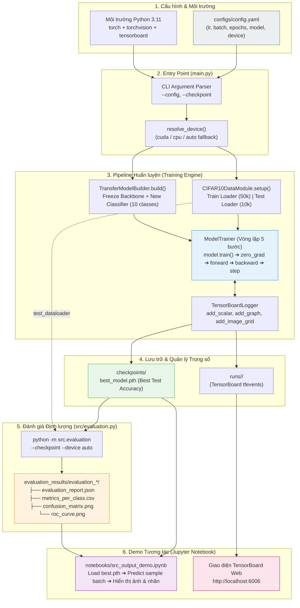

## 1. Purpose

Tài liệu này đặc tả toàn bộ quy trình **Demo tích hợp End-to-End** cho bài toán Transfer Learning phân loại ảnh CIFAR-10 trong Practice 2:

- **Tích hợp liên hoàn:** Kết nối 3 mắt xích độc lập đã hoàn thiện: Pipeline Dữ liệu (`data_module.py`), Động cơ Huấn luyện & Ghi nhật ký (`trainer.py`, `logger.py`) và Module Đánh giá định lượng (`evaluation.py`).
- **Giao diện vận hành thống nhất:** Cung cấp hướng dẫn triển khai từ môi trường sạch (`requirements.txt`), khởi chạy pipeline qua CLI (`main.py`), kiểm tra tham số bằng file cấu hình tập trung (`configs/config.yaml`), và kích hoạt resume training từ checkpoint `.pth`.
- **Trực quan hóa MLOps:** Hướng dẫn mở và khai thác bảng điều khiển TensorBoard (`runs/`) theo thời gian thực (đồ thị Loss/Accuracy, cấu trúc computational graph, grid ảnh mẫu).
- **Trình diễn kết quả thực nghiệm:** Kết nối checkpoint tốt nhất (`best_model.pth`) sang module đánh giá để xuất bộ 4 artifact chuẩn khoa học (`evaluation_results/`) và demo tương tác trực quan trên Jupyter Notebook (`notebooks/src_output_demo.ipynb`).
- **Phục hồi & Dung lỗi:** Định nghĩa kịch bản CPU Fallback khi CUDA không khả dụng, cơ chế kiểm tra checkpoint tương thích và xử lý ngoại lệ đầu vào.

---

## 2. Input/Output & Diagram

### 2.1 Hợp đồng Dữ liệu Vào / Ra (Input/Output Contract)

| Chiều      | Thành phần            | Kiểu / Định dạng            | Ví dụ / Quy cách                   | Mô tả chi tiết                                                                                                                                                           |
| :--------- | :-------------------- | :-------------------------- | :--------------------------------- | :----------------------------------------------------------------------------------------------------------------------------------------------------------------------- |
| **Input**  | File cấu hình         | YAML mapping (`.yaml`)      | `configs/config.yaml`              | Chứa 6 siêu tham số bắt buộc: `batch_size: 64`, `learning_rate: 0.001`, `epochs: 5`, `model_name: resnet18`, `device: cuda` (hoặc `cpu`/`auto`), `weight_decay: 0.0001`. |
| **Input**  | Dữ liệu thô           | Dataset CIFAR-10            | `data/cifar-10-batches-py/`        | Tải tự động qua `torchvision.datasets.CIFAR10(download=True)`, gồm 50.000 ảnh train và 10.000 ảnh test (gốc 32×32×3).                                                    |
| **Input**  | Pretrained Weights    | PyTorch Model Weights       | ImageNet Default Weights           | Tải qua `torchvision.models` tương ứng: `ResNet18_Weights.DEFAULT`, `VGG16_Weights.DEFAULT`, `DenseNet121_Weights.DEFAULT`.                                              |
| **Input**  | Checkpoint (tùy chọn) | Binary `.pth`               | `--checkpoint checkpoints/...`     | Sử dụng khi resume quá trình huấn luyện hoặc truyền vào module evaluation.                                                                                               |
| **Output** | Console Log           | Text Stream (stdout)        | `Epoch [1/5] \| Train Loss: ...`   | Hiển thị thông số runtime: Device, Model, Train/Test Loss và Train/Test Accuracy từng epoch.                                                                             |
| **Output** | TensorBoard Event     | Binary tfevents             | `runs/<experiment_name>/`          | Chứa Scalars (`Loss/*`, `Accuracy/*`), Model Graph, Image Grid mẫu và Configuration Text.                                                                                |
| **Output** | Checkpoints           | PyTorch State Dict (`.pth`) | `checkpoints/..._best.pth`         | Chứa `epoch`, `model_state_dict`, `optimizer_state_dict`, `metrics` (lưu khi test accuracy đạt đỉnh mới).                                                                |
| **Output** | Evaluation Artifacts  | JSON, CSV, PNG              | `evaluation_results/evaluation_*/` | Gồm: `evaluation_report.json`, `metrics_per_class.csv`, `confusion_matrix.png`, `roc_curve.png`.                                                                         |
| **Output** | Interactive Notebook  | Jupyter Notebook (`.ipynb`) | `notebooks/src_output_demo.ipynb`  | Trực quan hóa 8 ảnh ngẫu nhiên từ test set kèm nhãn thực tế vs nhãn mô hình dự đoán.                                                                                     |

---

### 2.2 Sơ đồ Luồng Vận Hành End-to-End (End-to-End Pipeline Diagram)



---

## 3. Success Criteria (Tiêu chí Đánh giá Thành công)

Một buổi demo hoặc một lần chạy tích hợp hoàn chỉnh được xác nhận là **THÀNH CÔNG (PASS)** khi thỏa mãn toàn bộ 8 tiêu chí kiểm định sau:

|    STT    | Tiêu chí                              | Ngưỡng định lượng / Ràng buộc kỹ thuật                                                                                                                    | Bằng chứng kiểm tra                                                                                                |
| :-------: | :------------------------------------ | :-------------------------------------------------------------------------------------------------------------------------------------------------------- | :----------------------------------------------------------------------------------------------------------------- |
| **SC-01** | **Khởi tạo môi trường**               | Import không lỗi `torch`, `torchvision`, `tensorboard`, `yaml`. Phiên bản Python 3.11+.                                                                   | `python -c "import torch, torchvision, yaml; print('PASS')"` trả về code 0.                                        |
| **SC-02** | **Cấu hình hợp lệ**                   | Các giá trị `batch_size > 0`, `learning_rate > 0`, `epochs > 0`, `weight_decay >= 0`. Tên model thuộc danh mục hỗ trợ.                                    | Hàm `load_config()` nạp đúng schema, báo `ValueError` rõ ràng khi cấu hình sai.                                    |
| **SC-03** | **Tính nguyên vẹn dữ liệu**           | `train_dataset` đủ 50.000 mẫu, `test_dataset` đủ 10.000 mẫu. Batch tensor shape đúng `[B, 3, 224, 224]`, labels shape `[B]`, giá trị labels $\in [0, 9]$. | Không có sample nào thiếu nhãn hoặc kích thước sai lệch; pipeline data hoàn toàn độc lập với split test.           |
| **SC-04** | **Bảo toàn Transfer Learning**        | Toàn bộ layer backbone được đóng băng (`requires_grad=False`). Chỉ các trọng số của classifier mới được mở gradient (`requires_grad=True`).               | Số lượng trainable parameters khớp thiết kế (ResNet-18: 5.130 tham số; VGG-16: 40.970; DenseNet-121: 10.250).      |
| **SC-05** | **Hội tụ & Giám sát huấn luyện**      | Loss hữu hạn (không chứa `NaN` hoặc `Inf`). Test accuracy tăng dần sau các epoch đầu và nằm trong đoạn $[0\%, 100\%]$.                                    | Console in đầy đủ log định dạng `Epoch [x/N] \| Train Loss: ...`. File event TensorBoard được tạo trong `runs/`.   |
| **SC-06** | **Tạo và Phục hồi Checkpoint**        | Checkpoint lưu thành công khi test accuracy vượt đỉnh cũ. File `.pth` chứa đủ: `model_state_dict`, `optimizer_state_dict`, `epoch`, `metrics`.            | Resume với flag `--checkpoint` khôi phục chính xác trạng thái và bắt đầu từ `epoch + 1`.                           |
| **SC-07** | **Xuất đầy đủ Artifacts Đánh giá**    | Thư mục `evaluation_results/` sinh ra 4 artifact nguyên vẹn: `evaluation_report.json`, `metrics_per_class.csv`, `confusion_matrix.png`, `roc_curve.png`.  | Confusion matrix đúng $10 \times 10$, AUC-ROC tính từ xác suất softmax trước `argmax` theo chiến lược One-vs-Rest. |
| **SC-08** | **Khả năng tái lập & Demo trực quan** | Notebook `src_output_demo.ipynb` chạy từ cell đầu đến cuối không vấp lỗi. TensorBoard mở tại port 6006 hiển thị đủ tabs Scalars, Images, Graphs.          | Ảnh hiển thị kèm nhãn thật (Ground Truth) và nhãn dự đoán (Predicted Label) chính xác với trực quan người nhìn.    |

---

## 4. How to do (Prompt + Smoke Test)

### 4.1 Bộ Prompt Chuẩn Hóa Điều Khiển Tác Vụ Demo

#### Prompt 1: Kịch bản Kiểm tra Khởi động Nhanh (Integration Smoke Test)
```text
Implement exactly one task: chạy smoke test tích hợp toàn bộ pipeline từ main.py.

Làm việc từ repository root và sử dụng cấu trúc module hiện tại:
- src/data_module.py
- src/model_builder.py
- src/trainer.py
- src/logger.py
- configs/config.yaml
- main.py

Yêu cầu:
1. Tạo một cấu hình thử nghiệm tạm thời configs/test_smoke.yaml với:
   batch_size: 4
   learning_rate: 0.001
   epochs: 1
   model_name: resnet18
   device: auto
   weight_decay: 0.0001
2. Chạy pipeline 1 epoch kiểm tra:
   - Quá trình nạp dữ liệu CIFAR-10.
   - Quá trình build mô hình pre-trained ResNet-18 và thay head 10 classes.
   - Vòng lặp training 1 epoch và validation 1 epoch.
   - Khởi tạo thư mục runs/ và checkpoints/.
3. Xác nhận loss và accuracy là số thực hữu hạn, không xuất hiện NaN/Inf.
4. Xóa file cấu hình tạm sau khi hoàn tất kiểm tra.

Sau khi chạy:
- Báo chính xác lệnh đã thực thi, output thực tế và mã thoát (exit code).
- Không sửa mã nguồn trong thư mục src/.
```

---

#### Prompt 2: Kịch bản Chạy Huấn luyện Chính thức (Run Baseline Training)
```text
Implement exactly one task: thực thi huấn luyện mô hình baseline theo configs/config.yaml.

Làm việc từ repository root.
Tham số cấu hình chuẩn:
- model_name: resnet18
- batch_size: 64
- learning_rate: 0.001
- epochs: 5
- weight_decay: 0.0001
- device: auto

Quy trình thực hiện:
1. Chạy lệnh: python main.py --config configs/config.yaml
2. Giám sát stdout: Ghi nhận device thực tế (CUDA/CPU), tiến độ tải weights và metrics từng epoch.
3. Kiểm tra artifact sinh ra sau khi chạy xong:
   - Thư mục log TensorBoard trong runs/ (chứa scalar loss/accuracy, sample images, graph).
   - Checkpoint tốt nhất trong checkpoints/cifar10_checkpoints/ (tên file chứa best_metric).
4. Báo cáo đường dẫn chính xác của file checkpoint .pth đã lưu để phục vụ bước evaluation.
```

---

#### Prompt 3: Kịch bản Đánh giá Chuyên sâu Checkpoint (Evaluation & Artifact Generation)
```text
Implement exactly one task: đánh giá checkpoint tốt nhất vừa huấn luyện bằng module src/evaluation.py.

Làm việc từ repository root.
Lệnh thực thi:
python -m src.evaluation --checkpoint <đường_dẫn_checkpoint_vừa_tạo.pth> --config configs/config.yaml --device auto

Yêu cầu báo cáo chi tiết:
1. Xác nhận 10.000 mẫu test đã được đánh giá (không rò rỉ tập train).
2. Trích xuất chỉ số tổng hợp: Test Accuracy, Macro Precision, Macro Recall, Macro F1-score, Macro AUC-ROC.
3. Liệt kê top 3 cặp lớp dễ bị nhầm lẫn nhất từ ma trận nhầm lẫn (Confusion Matrix).
4. Xác nhận sự tồn tại của 4 files trong evaluation_results/evaluation_<timestamp>/:
   - evaluation_report.json
   - metrics_per_class.csv
   - confusion_matrix.png
   - roc_curve.png
```

---

#### Prompt 4: Xây dựng Kịch bản Demo Trực quan trên Notebook (`notebooks/src_output_demo.ipynb`)
```text
Implement exactly one task: hoàn thiện notebook tương tác notebooks/src_output_demo.ipynb để trình diễn kết quả.

Yêu cầu các ô mã nguồn (cells) tuần tự:
Cell 1: Import torch, torchvision, matplotlib, json, yaml, và các module từ src (CIFAR10DataModule, TransferModelBuilder).
Cell 2: Load checkpoint tốt nhất từ checkpoints/cifar10_checkpoints/ và cấu hình configs/config.yaml.
Cell 3: Khởi tạo CIFAR10DataModule, lấy 1 mini-batch từ test_dataloader() và un-normalize ảnh về dải màu chuẩn [0, 1].
Cell 4: Chạy forward pass ở chế độ eval (torch.no_grad), lấy xác suất softmax và nhãn dự đoán (argmax).
Cell 5: Trực quan hóa grid 8 ảnh test bằng matplotlib:
        - Hiển thị ảnh RGB.
        - Tiêu đề từng ảnh: Màu xanh nếu Đúng [True: Label | Pred: Label], Màu đỏ nếu Sai.
Cell 6: Đọc và hiển thị biểu đồ confusion_matrix.png cùng bảng tổng hợp metrics_per_class.csv từ kết quả evaluation mới nhất.
```

---

### 4.2 Kịch bản Thực thi Demo Thực tế (Step-by-Step Execution Runbook)

Dưới đây là chuỗi lệnh thực thi mẫu chuẩn mực dành cho người trình bày demo (thực hiện từ thư mục gốc của repository):

#### Bước 1: Khởi tạo và Xác thực Môi trường Thực thi
```bash
# 1.1 Kiểm tra phiên bản Python
python --version  # Yêu cầu: Python 3.11.x

# 1.2 Kích hoạt Virtual Environment (macOS/Linux)
source venv/bin/activate
# Hoặc trên Windows:
# .\venv\Scripts\activate

# 1.3 Cài đặt thư viện phụ thuộc
pip install -r requirements.txt

# 1.4 Kiểm tra khả năng nhận diện thiết bị tính toán (CUDA / CPU)
python -c "
import torch, torchvision, yaml
print('PyTorch Version   :', torch.__version__)
print('Torchvision       :', torchvision.__version__)
print('CUDA Available    :', torch.cuda.is_available())
if torch.cuda.is_available():
    print('Device Name       :', torch.cuda.get_device_name(0))
"
```

---

#### Bước 2: Chạy Kiểm thử Khởi động (Smoke Run - 1 Epoch Nhanh)
```bash
# Tạo cấu hình tạm cho smoke run
python -c "
import yaml
with open('configs/config.yaml', 'r') as f:
    cfg = yaml.safe_load(f)
cfg['epochs'] = 1
cfg['batch_size'] = 16
cfg['device'] = 'auto'
with open('configs/smoke_config.yaml', 'w') as f:
    yaml.safe_dump(cfg, f)
print('Đã tạo configs/smoke_config.yaml')
"

# Thực thi smoke pipeline
python main.py --config configs/smoke_config.yaml

# Dọn dẹp cấu hình tạm
rm configs/smoke_config.yaml
```

---

#### Bước 3: Chạy Huấn luyện Baseline Chính thức (5 Epochs)
```bash
# Khởi chạy pipeline chính thức với cấu hình chuẩn
python main.py --config configs/config.yaml
```
*Kỳ vọng đầu ra console:*
```text
Device: cuda (hoặc cpu)
Loading CIFAR-10 data...
Files already downloaded and verified
Files already downloaded and verified
Building pretrained model: resnet18
Epoch [1/5] | Train Loss: 1.2450 | Train Acc: 58.20% | Test Loss: 0.8120 | Test Acc: 72.10%
[Checkpoint] Saved best model (metric=72.10) -> checkpoints/cifar10_checkpoints/resnet18_..._best.pth
...
Epoch [5/5] | Train Loss: 0.6120 | Train Acc: 79.40% | Test Loss: 0.5890 | Test Acc: 81.05%
[Checkpoint] Saved best model (metric=81.05) -> checkpoints/cifar10_checkpoints/resnet18_..._best.pth
Best checkpoint: ...
TensorBoard logs: runs/...
```

---

#### Bước 4: Trực quan hóa MLOps với TensorBoard
```bash
# Khởi chạy TensorBoard server ngầm
tensorboard --logdir=runs --port=6006
```
- Mở trình duyệt web truy cập: `http://localhost:6006`
- **Tab Scalars:** Quan sát đường cong hội tụ song song giữa `Loss/train` vs `Loss/test` và `Accuracy/train` vs `Accuracy/test`.
- **Tab Images:** Kiểm tra `Samples/train` xem grid ảnh CIFAR-10 mẫu đã được khử chuẩn hóa (un-normalize) hiển thị đúng màu RGB.
- **Tab Graphs:** Nhấp kiểm tra đồ thị cấu trúc mạng ResNet-18 từ tầng Conv đầu tiên đến tầng `fc` mới (10 ngõ ra).
- **Tab Text:** Kiểm tra nội dung file cấu hình YAML đã được lưu vết tự động.

---

#### Bước 5: Chạy Đánh giá Toàn diện trên Test Set (10.000 Ảnh)
```bash
# Tìm đường dẫn file checkpoint tốt nhất vừa lưu
CHECKPOINT_PATH=$(find checkpoints -name "*_best.pth" | head -n 1)
echo "Đánh giá checkpoint: $CHECKPOINT_PATH"

# Kích hoạt module evaluation
python -m src.evaluation \
    --checkpoint "$CHECKPOINT_PATH" \
    --config configs/config.yaml \
    --device auto
```
*Kỳ vọng đầu ra console:*
```text
Evaluation samples: 10000
Accuracy: 0.8105
Macro Precision: 0.8113
Macro Recall: 0.8105
Macro F1: 0.8088
Macro AUC-ROC: 0.9808
Artifacts: evaluation_results/evaluation_20261104_...
```

---

#### Bước 6: Kiểm tra Bằng chứng Thực nghiệm (Artifact Verification)
```bash
# Liệt kê các artifacts vừa được trích xuất
ls -la evaluation_results/evaluation_*/

# Xem tóm tắt kết quả JSON
python -m json.tool evaluation_results/evaluation_*/evaluation_report.json | head -n 40

# Mở biểu đồ ma trận nhầm lẫn và đường cong ROC (macOS)
open evaluation_results/evaluation_*/confusion_matrix.png
open evaluation_results/evaluation_*/roc_curve.png
```

---

#### Bước 7: Kịch bản Phục hồi Huấn luyện (Resume Training Demo)
```bash
# Kiểm tra tính năng nạp lại checkpoint để tiếp tục huấn luyện mà không mất trạng thái
python main.py \
    --config configs/config.yaml \
    --checkpoint "$CHECKPOINT_PATH"
```
*Kỳ vọng console:* Xác nhận nạp thành công trọng số, optimizer state và tiếp tục tăng epoch từ `start_epoch = checkpoint_epoch + 1`.

---

## 5. Bảng Đối chiếu Xử lý Sự cố khi Demo (Troubleshooting Guide)

| Tình huống / Lỗi gặp phải                                      | Nguyên nhân gốc rễ                                                                                  | Biện pháp xử lý ngay tại buổi Demo                                                                                                                                                  |
| :------------------------------------------------------------- | :-------------------------------------------------------------------------------------------------- | :---------------------------------------------------------------------------------------------------------------------------------------------------------------------------------- |
| `RuntimeError: CUDA was requested but is not available.`       | Máy demo không có GPU NVIDIA hoặc chưa cài driver CUDA tương thích.                                 | Đổi tham số `device: auto` hoặc `device: cpu` trong `configs/config.yaml` hoặc command line `--device auto`. Pipeline sẽ tự động chuyển sang chế độ CPU mà không dừng chương trình. |
| `FileNotFoundError: Checkpoint file not found`                 | Đường dẫn checkpoint truyền vào `--checkpoint` bị sai hoặc file chưa sinh ra.                       | Sử dụng lệnh tìm kiếm tự động: `find checkpoints -name "*.pth"` hoặc gõ đường dẫn tương đối chuẩn xác từ thư mục gốc.                                                               |
| `ValueError: Expected 10 output classes, received 1000`        | Model chưa được chuyển giao qua `TransferModelBuilder` mà dùng trực tiếp model gốc của torchvision. | Kiểm tra lại khởi tạo: phải dùng `TransferModelBuilder(model_name, num_classes=10)` để thay thế `model.fc` hoặc `model.classifier`.                                                 |
| Port 6006 bị chiếm dụng (`TensorBoard address already in use`) | Một tiến trình TensorBoard cũ đang chạy ngầm trên máy.                                              | Chỉ định port khác khi khởi chạy: `tensorboard --logdir=runs --port=6007` hoặc tắt tiến trình cũ (`kill $(lsof -t -i:6006)`).                                                       |
| Trục ma trận nhầm lẫn bị đảo ngược                             | Hiểu nhầm giữa nhãn thực tế và nhãn dự đoán trong `evaluation.py`.                                  | Kiểm tra file `confusion_matrix.png`: Hàng (Rows) luôn là **True Label**, Cột (Columns) luôn là **Predicted Label** theo chuẩn của dự án.                                           |

---

## 6. Definition of Done (Định nghĩa Hoàn tất Tác vụ)

Tác vụ viết tài liệu và triển khai kịch bản demo chỉ được nghiệm thu khi:
1. File [`docs/demo.md`](file:///Users/nhuttan/Documents/DEEP_LEARNING/Practice-2---Hands-on-practice-with-pre-trained-neural-network-architectures/docs/demo.md) được cập nhật hoàn chỉnh theo 4 mục chuẩn hóa `Purpose ⟶ Input/Output & Diagram ⟶ Success Criteria ⟶ How to do`.
2. Toàn bộ các câu lệnh trong mục 4.2 được chạy thử nghiệm thực tế từ repository root và trả về kết quả thành công.
3. Thư mục artifacts `runs/`, `checkpoints/` và `evaluation_results/` có cấu trúc tệp tin khớp với mô tả.
4. Tài liệu không chứa thông tin nhạy cảm, token, secret hoặc đường dẫn tuyệt đối cứng cục bộ.
