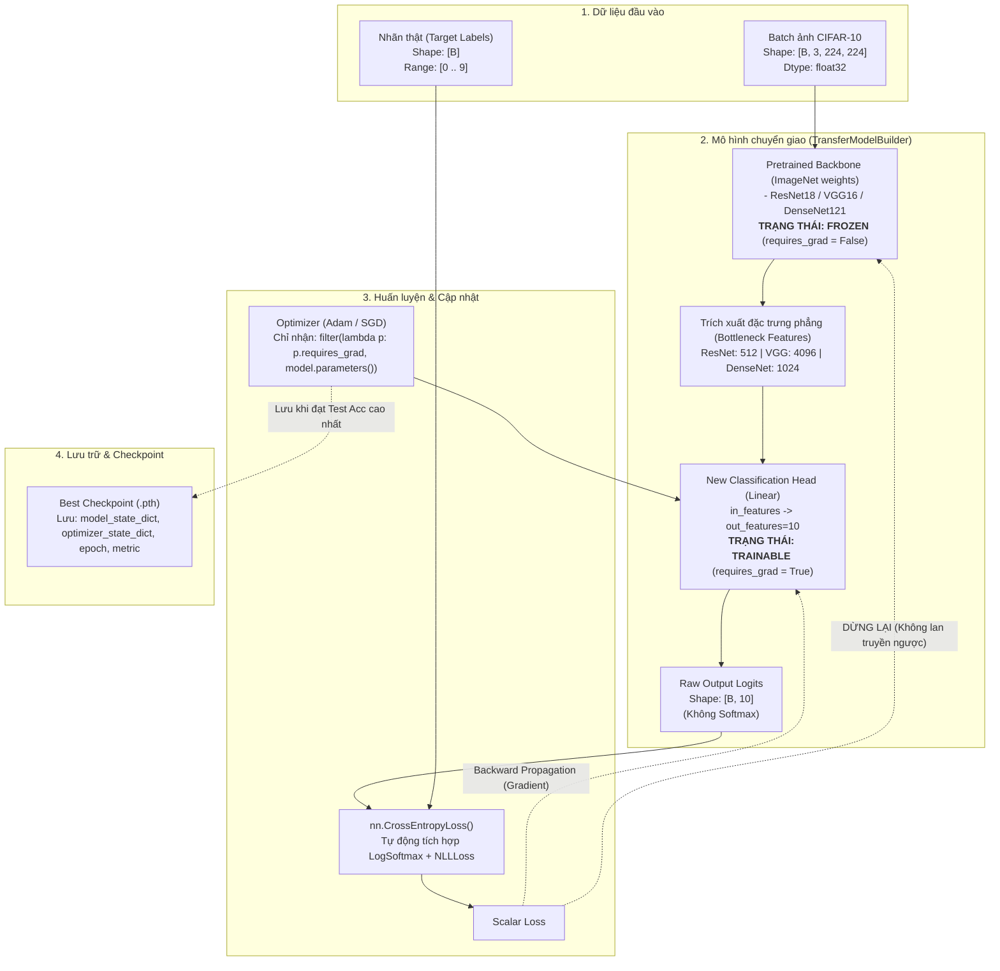

# Model Specification Plan (Version 1.0)

> **Document Metadata**
> - **Module Name:** `src/model_builder.py` (`TransferModelBuilder`)
> - **Created Date:** 07/11/2026
> - **Last Updated:** 07/11/2026
> - **Target Dataset:** CIFAR-10 (10 classes: airplane, automobile, bird, cat, deer, dog, frog, horse, ship, truck)

---

## 1. Purpose (Mục đích)

Mục đích chính của module `model_builder` là xây dựng kiến trúc mạng nơ-ron thông qua kỹ thuật **Transfer Learning (Chuyển giao học tập)** từ các mô hình học sâu hiện đại đã được tiền huấn luyện (pre-trained) trên tập dữ liệu quy mô lớn ImageNet-1k, nhằm giải quyết bài toán phân loại 10 lớp ảnh của CIFAR-10.

### Lý do & Vai trò kỹ thuật:
1. **Tận dụng đặc trưng đã học (Feature Reusability):** ImageNet chứa hơn 1.4 triệu ảnh với 1.000 danh mục đa dạng. Các tầng tích chập sâu (Backbone) đã học được những bộ trích xuất đặc trưng thị giác khái quát rất tốt (từ cạnh, góc, vân bề mặt cho tới các hình thái phức tạp).
2. **Đóng băng Backbone (Freeze Feature Extractor):** CIFAR-10 có kích thước nhỏ (50.000 ảnh train). Việc đóng băng toàn bộ backbone giúp:
   - Ngăn chặn hiện tượng phá hủy các trọng số tốt đã học (*catastrophic forgetting*).
   - Giảm đáng kể số lượng tham số cần tối ưu (giảm từ hàng chục triệu tham số xuống chỉ còn vài nghìn tham số ở lớp cuối).
   - Tăng tốc độ huấn luyện trên mỗi epoch và chống hiện tượng quá khớp (*overfitting*).
3. **Thay thế Head phân loại (Classifier Adaptation):** Thay thế lớp Linear cuối cùng (vốn có 1.000 đầu ra trên ImageNet) thành lớp Linear mới có đúng 10 đầu ra tương ứng với 10 lớp của CIFAR-10.
4. **Hỗ trợ đa kiến trúc (Multi-architecture Support):** Module cung cấp interface thống nhất theo mô hình Factory Pattern để khởi tạo linh hoạt 3 kiến trúc bắt buộc:
   - **ResNet-18** (Residual Connections)
   - **VGG-16** (Deep Sequential Convolutional Network)
   - **DenseNet-121** (Dense Feature Reuse Connections)

---

## 2. Input/Output & Training Diagram (Đầu vào/Đầu ra & Sơ đồ kiến trúc)

### 2.1 Chi tiết Input / Output Contract

| Thuộc tính | Đầu vào (Input Tensor) | Đầu ra (Output Tensor / Logits) |
| :--- | :--- | :--- |
| **Shape** | `[batch_size, 3, 224, 224]` | `[batch_size, 10]` |
| **Data Type** | `torch.float32` | `torch.float32` |
| **Chuẩn hóa / Giá trị** | Đã Resize `224x224`, chuẩn hóa theo ImageNet:<br>`mean = [0.485, 0.456, 0.406]`<br>`std = [0.229, 0.224, 0.225]` | Raw Logits unnormalized ($(-\infty, +\infty)$)<br>*(Tuyệt đối không áp dụng Softmax trước khi đưa vào Loss)* |
| **Mục đích sử dụng** | Batch ảnh truyền từ DataLoader | Đưa trực tiếp vào `nn.CrossEntropyLoss()` để tính mất mát |

---

### 2.2 So sánh Initial Model và Adapted Model

```text
1. ResNet-18:
   - Initial Model (ImageNet): model.fc = Linear(in_features=512, out_features=1000)
   - Adapted Model (CIFAR-10):  model.fc = Linear(in_features=512, out_features=10)
   - Backbone: Toàn bộ conv1, bn1, layer1 -> layer4 đều được freeze (requires_grad = False).

2. VGG-16:
   - Initial Model (ImageNet): model.classifier[6] = Linear(in_features=4096, out_features=1000)
   - Adapted Model (CIFAR-10):  model.classifier[6] = Linear(in_features=4096, out_features=10)
   - Backbone: model.features và model.classifier[0..5] đều được freeze.

3. DenseNet-121:
   - Initial Model (ImageNet): model.classifier = Linear(in_features=1024, out_features=1000)
   - Adapted Model (CIFAR-10):  model.classifier = Linear(in_features=1024, out_features=10)
   - Backbone: model.features được freeze toàn bộ.
```

---

### 2.3 Sơ đồ huấn luyện (Output Training Diagram)



---

## 3. Success Criteria (Tiêu chí thành công & Nghiệm thu)

Một mô hình do `TransferModelBuilder` tạo ra chỉ được nghiệm thu đạt chuẩn (**PASS**) khi thỏa mãn toàn bộ các tiêu chí định lượng sau:

| STT | Tiêu chí (Criteria) | Điều kiện chấp thuận (Acceptance Condition) | Cách kiểm tra |
| :---: | :--- | :--- | :--- |
| **1** | **Output Classes** | `out_features == 10` cho cả 3 kiến trúc (`resnet18`, `vgg16`, `densenet121`). | Kiểm tra layer cuối của model. |
| **2** | **Freeze Backbone** | 100% parameter thuộc backbone có `requires_grad == False`. | Quét `for name, p in model.named_parameters()`. |
| **3** | **Trainable Classifier** | 100% parameter của head mới có `requires_grad == True`. | `p.requires_grad == True` chỉ xuất hiện ở `fc` hoặc `classifier`. |
| **4** | **Forward Shape** | Input `[B, 3, 224, 224]` cho đúng Output `[B, 10]`. | `model(torch.randn(B, 3, 224, 224)).shape == (B, 10)`. |
| **5** | **Tính hữu hạn** | Đầu ra không chứa `NaN`, không chứa `Inf`. | `torch.isfinite(output).all() == True`. |
| **6** | **Tỷ lệ tham số học** | Số tham số học (*trainable params*) chiếm tỷ lệ nhỏ (< 1% tổng tham số):<br>- **ResNet-18:** ~5.130 / ~11.18M params (~0.05%)<br>- **VGG-16:** ~40.970 / ~134.27M params (~0.03%)<br>- **DenseNet-121:** ~10.250 / ~6.96M params (~0.15%) | Tính tổng: `sum(p.numel() for p in model.parameters() if p.requires_grad)`. |
| **7** | **Bẫy lỗi hợp lệ** | Khi nhập sai `model_name` hoặc `num_classes <= 0`, ném ra `ValueError` rõ ràng. | Test với pytest raises `ValueError`. |
| **8** | **Không dùng Softmax** | Model trả về Logits thô; không bọc `nn.Softmax` ở cuối. | Kiểm tra kiến trúc module con cuối cùng là `nn.Linear`. |

---

## 4. How to do (Cách thực hiện & Hướng dẫn triển khai)

### 4.1 Quy trình kỹ thuật từng bước (Step-by-step Implementation)

1. **Bước 1: Nạp kiến trúc và trọng số chính thức:**
   - Dùng API mới nhất của torchvision (`torchvision.models.*_Weights.DEFAULT`).
   - Tránh dùng cờ cũ `pretrained=True` (đã bị deprecated trong các phiên bản mới của torchvision).
2. **Bước 2: Đóng băng toàn bộ trọng số (Freezing):**
   ```python
   for param in model.parameters():
       param.requires_grad = False
   ```
3. **Bước 3: Thay thế lớp phân loại tương ứng theo từng kiến trúc:**
   - **ResNet-18:**
     ```python
     in_features = model.fc.in_features
     model.fc = nn.Linear(in_features, num_classes)
     ```
   - **VGG-16:**
     ```python
     in_features = model.classifier[6].in_features
     model.classifier[6] = nn.Linear(in_features, num_classes)
     ```
   - **DenseNet-121:**
     ```python
     in_features = model.classifier.in_features
     model.classifier = nn.Linear(in_features, num_classes)
     ```
4. **Bước 4: Thiết lập lớp phân loại mới ở chế độ học:**
   - Mặc định khi khởi tạo `nn.Linear`, các tham số của nó đã có `requires_grad = True`.
5. **Bước 5: Đóng gói thành Factory Builder:**
   - Xây dựng lớp trung gian `TransferModelBuilder(model_name, num_classes, pretrained)` chuẩn hóa tên và phân phối builder tương ứng.

---

### 4.2 Build Prompt cho AI (Independent Prompt)

Dán đoạn sau vào AI khi cần tạo mới hoặc cập nhật module model:

```text
Repository root:
D:\UTH\Deeplearning\lab\Practice-2---Hands-on-practice-with-pre-trained-neural-network-architectures

Implement exactly one task: hoàn thiện model builder cho transfer learning trong src/model_builder.py.

Chỉ được sửa:
- src/model_builder.py

Yêu cầu:
1. Hỗ trợ đầy đủ 3 kiến trúc: ResNet-18, VGG-16, DenseNet-121.
2. Dùng API weights hiện hành của torchvision (ResNet18_Weights.DEFAULT, VGG16_Weights.DEFAULT, DenseNet121_Weights.DEFAULT).
3. Đóng băng (requires_grad = False) toàn bộ backbone của mô hình.
4. Thay thế lớp classification head cuối cùng có out_features = 10 classes:
   - ResNet: model.fc
   - VGG: model.classifier[6]
   - DenseNet: model.classifier
5. Đảm bảo chỉ có classifier mới là trainable (requires_grad = True).
6. Tên model không hợp lệ phải ném ValueError kèm danh sách các lựa chọn được hỗ trợ.
7. Model trả về raw logits 2 chiều [batch_size, 10], tuyệt đối không dùng softmax nội bộ.

Sau khi sửa:
1. Chạy import test:
   .\venv\Scripts\python.exe -c "from src.model_builder import TransferModelBuilder; print('Import PASS')"
2. Chạy forward smoke test cho cả 3 kiến trúc:
   .\venv\Scripts\python.exe -c "import torch; from src.model_builder import TransferModelBuilder; x = torch.randn(2, 3, 224, 224); [print(m, TransferModelBuilder(m, 10, pretrained=False).build()(x).shape) for m in ['resnet18', 'vgg16', 'densenet121']]"
3. Báo logits shape [2, 10], tổng số tham số và số tham số trainable của từng mô hình.
4. Không sửa file ngoài phạm vi.
```

---

### 4.3 Lệnh kiểm tra và xác minh (Verification Commands)

#### Lệnh 1: Chạy toàn bộ Unit Tests chuyên biệt cho Model Builder
```powershell
.\venv\Scripts\python.exe -m pytest tests/test_model_builder.py -v
```

#### Lệnh 2: Kiểm tra số lượng tham số tổng và tham số Trainable
```powershell
.\venv\Scripts\python.exe -c "from src.model_builder import TransferModelBuilder; [print(f'=== {m.upper()} ===\nTotal params: {sum(p.numel() for p in model.parameters()):,}\nTrainable params: {sum(p.numel() for p in model.parameters() if p.requires_grad):,}') for m in ['resnet18', 'vgg16', 'densenet121'] for model in [TransferModelBuilder(m, 10, pretrained=False).build()]]"
```
*(Kết quả mong đợi: Toàn bộ 11 tests passed, Trainable params chỉ từ vài nghìn đến vài chục nghìn).*

